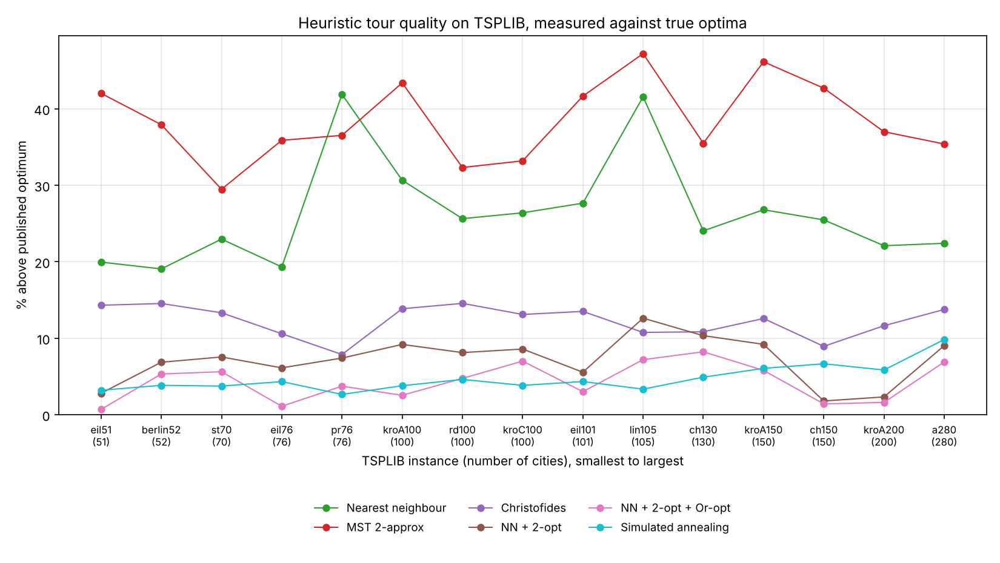
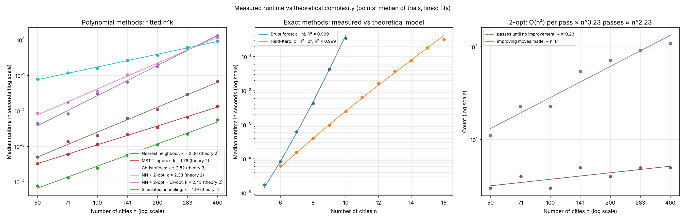

# TSP: Exact vs Approximate Algorithms

Design and Analysis of Algorithms course project, extended afterwards. It compares exact, approximate and local-search solvers for the Travelling Salesperson Problem, measuring how runtime grows with problem size and how close each method gets to the optimal tour.

The original course code was lost, so the course part of this repository is a rebuild. Later additions are labelled as extensions.

## Algorithms

**Course project**

| Method | Type | Time complexity | Guarantee |
|---|---|---|---|
| Brute force | Exact | O(n!) | Optimal |
| Held–Karp (DP over subsets) | Exact | O(n²·2ⁿ), memory O(n·2ⁿ) | Optimal |
| Nearest neighbour | Greedy | O(n²) | None |
| MST preorder walk | Approximation | O(n²) | ≤ 2 × optimal (metric instances) |

**Extension 1: stronger heuristics**

| Method | Type | Cost | Guarantee |
|---|---|---|---|
| Christofides | Approximation | O(n³), dominated by the matching | ≤ 1.5 × optimal (metric instances) |
| NN + 2-opt | Local search | O(n²) per pass | 2-opt local optimum |
| NN + 2-opt + Or-opt | Local search | O(n²) per pass | Local optimum for both move types |
| Simulated annealing | Metaheuristic | Fixed budget, 2000·n random 2-opt moves | None |

## Run

```bash
pip install -r requirements.txt
python test_solvers.py   # correctness checks
python test_tsplib.py    # TSPLIB loader checks
python benchmark.py      # random instances, 5 trials per size; writes results.csv and two plots
python run_tsplib.py     # TSPLIB instances; writes tsplib_results.csv and tsplib_gap.png
python complexity.py     # complexity analysis; writes complexity.csv and complexity.png (about 1 minute)
```

## Results on random instances

Random Euclidean instances in a 100 × 100 square, mean of 5 trials per size.

### Runtime


- **Brute force** grows factorially and takes about 0.4 s at n = 10.
- **Held–Karp** grows about 2.3× per added city. That matches the n²·2ⁿ bound, which predicts 2·(n+1)²/n² ≈ 2.3 for n between 10 and 15. It reaches n = 15 in about 0.23 s.
- **Nearest neighbour and MST** stay in the low milliseconds even at n = 200.
- **Christofides and 2-opt + Or-opt** take about 0.2 s at n = 200. **Simulated annealing** takes about 0.4 s at its fixed budget.

### Solution quality


For n ≤ 15 each tour is compared with the exact optimum. For larger n no optimum is available, so tours are compared with the best tour any solver found on that instance. Gaps on the right of the dashed line are therefore relative and understate the true distance from optimal. TSPLIB instances with published optima come in Extension 2.

On the 30 instances with 10 ≤ n ≤ 15, where the optimum is known:

| Method | Mean gap | Worst gap | Optimal tours found |
|---|---|---|---|
| Nearest neighbour | 15.2% | 33.4% | 1 / 30 |
| MST 2-approx | 18.5% | 41.2% | 1 / 30 |
| Christofides | 6.0% | 18.9% | 3 / 30 |
| NN + 2-opt | 1.1% | 17.5% | 23 / 30 |
| NN + 2-opt + Or-opt | 0.0% | 0.0% | 30 / 30 |
| Simulated annealing | 0.0% | 0.0% | 30 / 30 |

Main observations:

- **Worst-case guarantees don't predict typical quality.** Christofides has the best proven bound (1.5×), yet plain 2-opt beats it on most instances. Both constructive approximations land far inside their bounds (≤ 41% against an allowed 100%, ≤ 19% against an allowed 50%).
- **Combining move types matters.** 2-opt alone gets stuck in local optima (worst case 17.5%). Adding Or-opt, which relocates short chains of cities that 2-opt cannot move, found the optimum on all 30 small instances.
- **A fixed budget stops scaling.** Simulated annealing matches the best tours up to n = 50 but falls behind 2-opt + Or-opt by n = 200 (about 3% worse), because its number of moves per city stays constant while the search space grows.

## Extension 2: TSPLIB benchmarks against published optima

The gaps above for n > 15 are only relative to the best tour found. To measure true quality, every heuristic was run on 15 instances from [TSPLIB](http://comopt.ifi.uni-heidelberg.de/software/TSPLIB95/) (Reinelt, 1991), the standard TSP benchmark library. The instances range from 51 to 280 cities, and each has a proven optimal tour length.

TSPLIB's EUC_2D distances are rounded to the nearest integer, and the published optima use that rounding, so the loader rounds the same way. As a check, a test confirms that no solver ever reports a tour shorter than the published optimum.



Mean over the 15 instances (simulated annealing averaged over 3 random seeds):

| Method | Mean gap | Worst gap | Best gap | Mean time (s) |
|---|---|---|---|---|
| Nearest neighbour | 26.4% | 41.9% | 19.1% | 0.001 |
| MST 2-approx | 38.4% | 47.2% | 29.5% | 0.002 |
| Christofides | 12.3% | 14.6% | 7.9% | 0.078 |
| NN + 2-opt | 7.2% | 12.6% | 1.8% | 0.006 |
| NN + 2-opt + Or-opt | 4.3% | 8.2% | 0.7% | 0.086 |
| Simulated annealing | 4.7% | 9.8% | 2.7% | 0.251 |

Main observations:

- **True gaps are larger than the random-instance estimates suggested.** On random instances above 15 cities, 2-opt + Or-opt looked within 0–3% of the best tour found, because it usually *was* the best tour found. Against real optima it averages 4.3% above. Comparing heuristics only with each other hides how far all of them are from optimal.
- **The ranking from random instances holds.** NN + 2-opt beat Christofides on 14 of the 15 instances, despite having no worst-case guarantee, and the combined local search remains the best method overall.
- **Simulated annealing's fixed budget shows up again.** It beat 2-opt + Or-opt on 5 of the 8 instances with up to 101 cities, but only 2 of the 7 larger ones, and it is the slowest method.
- **Nearest neighbour is the least predictable.** It is 19–23% above optimal on the four smallest instances but about 42% on pr76 and lin105, which shows how much a greedy method depends on the layout of the instance.

## Extension 3: empirical complexity analysis

`complexity.py` times every solver over a range of sizes (median of 5 runs per size) and checks the measurements against theory. Polynomial methods are fitted to runtime ≈ c·nᵏ on a log-log scale. Exact methods are fitted to runtime ≈ c·f(n), using n! for brute force and n²·2ⁿ for Held–Karp.



**Exact methods match their models almost exactly.**

| Method | Model | R² | Growth per added city, measured | Predicted |
|---|---|---|---|---|
| Brute force | n! ((n−1)! tours, O(n) each) | 0.999 | 9.1–9.5× | 9.5× |
| Held–Karp | n²·2ⁿ | 0.999 | 2.1–2.3× | 2.3× |

Held–Karp's peak memory also roughly doubled with each added city (2.10–2.19×, against 2.14–2.25× predicted by its O(n·2ⁿ) space bound), reaching about 15 MB at n = 15. Extrapolating, this Python implementation would need roughly 0.6 GB at n = 20 and over 20 GB at n = 25, so memory runs out at about the same point as patience.

**Polynomial methods: fitted exponent k in runtime ≈ c·nᵏ** (n = 50 to 400)

| Method | Fitted k | Theory | Explanation |
|---|---|---|---|
| Nearest neighbour | 2.06 | 2 | n steps, each scanning up to n cities |
| MST 2-approx | 1.76 | 2 | Prim's algorithm on a dense graph |
| Christofides | 2.82 | 3 (worst case) | the matching step dominates; O(n³) is a worst-case bound |
| NN + 2-opt | 2.33 | 2 per pass | see below |
| NN + 2-opt + Or-opt | 2.43 | 2 per pass | as 2-opt |
| Simulated annealing | 1.19 | 1 | fixed 2000·n moves, but each accepted move reverses a segment of up to n cities |

All fits have R² ≥ 0.99. Exponents vary by about ±0.2 between runs, because timings on a shared machine are noisy, so differences smaller than that should not be read into.

**Why 2-opt grows faster than n².** One 2-opt pass checks every pair of edges, which is O(n²). But the search repeats passes until nothing improves, and the number of passes grows too. Counting them (third panel) gave passes ≈ n^0.23, which predicts a total of about n^2.23. That accounts for most of the measured n^2.33–2.41. The remainder fits the cost of applying improving moves: their number grows roughly linearly (≈ n^1.11), and each reverses a segment of up to n cities. "O(n²) per pass" understates the real cost of local search, because the number of passes is not constant.

## Files

- `tsp_solvers.py`: all solvers and instance helpers
- `benchmark.py`: random-instance benchmark: timing, optimality gap, CSV output and plots
- `tsplib.py`: TSPLIB parser, rounded distance matrix and published optima
- `run_tsplib.py`: TSPLIB benchmark
- `complexity.py`: empirical complexity analysis (runtime fits, 2-opt pass counts, Held–Karp memory)
- `data/tsplib/`: the 15 bundled TSPLIB instances and their optimal tour lengths
- `test_solvers.py`: correctness tests (exact methods agree, approximation bounds hold, local search never worsens its starting tour)
- `test_tsplib.py`: TSPLIB loader tests (parsing, distance rounding, no tour beats the optimum)

## Planned extensions

- **Extension 4:** comparison with a pretrained neural TSP solver, including generalisation to larger n and real instances
