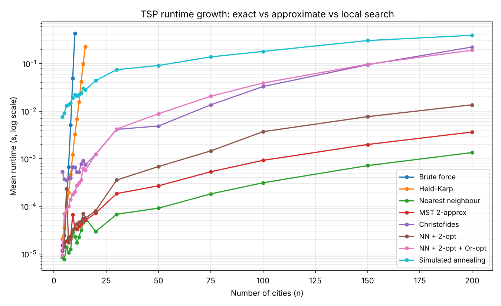
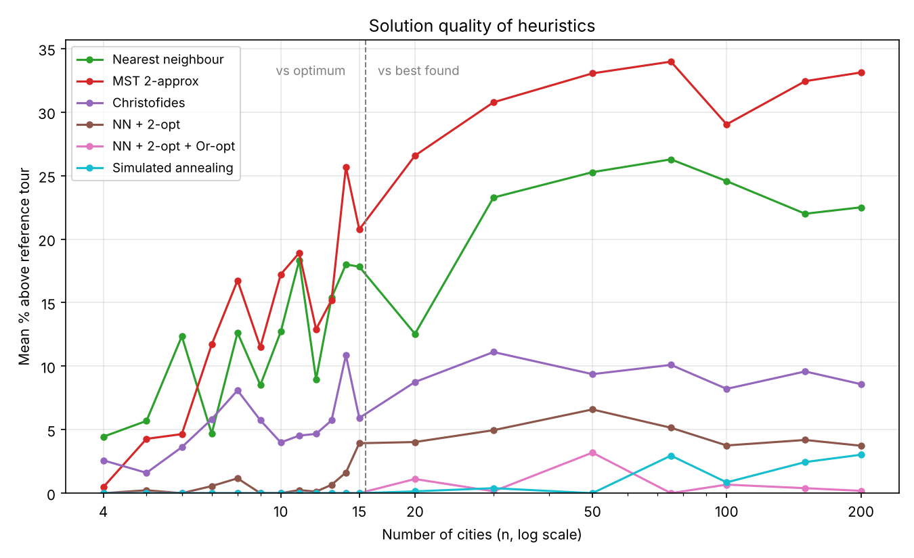

# TSP: Exact vs Approximate Algorithms

Design and Analysis of Algorithms course project, extended afterwards. It compares exact, approximate and local-search solvers for the Travelling Salesperson Problem, measuring how runtime grows with problem size and how close each method gets to the optimal tour.

The original course code was lost, so the course part of this repository is a rebuild. Later additions are labelled as extensions.

## Algorithms

**Course project**

| Method | Type | Time complexity | Guarantee |
|---|---|---|---|
| Brute force | Exact | O(n!) | Optimal |
| Held–Karp (DP over subsets) | Exact | O(n²·2ⁿ), memory O(n·2ⁿ) | Optimal |
| Nearest neighbour | Greedy | O(n²) | None |
| MST preorder walk | Approximation | O(n²) | ≤ 2 × optimal (metric instances) |

**Extension 1: stronger heuristics**

| Method | Type | Cost | Guarantee |
|---|---|---|---|
| Christofides | Approximation | O(n³), dominated by the matching | ≤ 1.5 × optimal (metric instances) |
| NN + 2-opt | Local search | O(n²) per pass | 2-opt local optimum |
| NN + 2-opt + Or-opt | Local search | O(n²) per pass | Local optimum for both move types |
| Simulated annealing | Metaheuristic | Fixed budget, 2000·n random 2-opt moves | None |

## Run

```bash
pip install -r requirements.txt
python test_solvers.py   # correctness checks
python benchmark.py      # 5 trials per size; writes results.csv and two plots
```

## Results

Random Euclidean instances in a 100 × 100 square, mean of 5 trials per size.

### Runtime



- **Brute force** grows factorially and takes about 0.4 s at n = 10.
- **Held–Karp** grows about 2.3× per added city. That matches the n²·2ⁿ bound, which predicts 2·(n+1)²/n² ≈ 2.3 for n between 10 and 15. It reaches n = 15 in about 0.23 s.
- **Nearest neighbour and MST** stay in the low milliseconds even at n = 200.
- **Christofides and 2-opt + Or-opt** take about 0.2 s at n = 200. **Simulated annealing** takes about 0.4 s at its fixed budget.

### Solution quality



For n ≤ 15 each tour is compared with the exact optimum. For larger n no optimum is available, so tours are compared with the best tour any solver found on that instance. Gaps on the right of the dashed line are therefore relative and understate the true distance from optimal. TSPLIB instances with published optima come in Extension 2.

On the 30 instances with 10 ≤ n ≤ 15, where the optimum is known:

| Method | Mean gap | Worst gap | Optimal tours found |
|---|---|---|---|
| Nearest neighbour | 15.2% | 33.4% | 1 / 30 |
| MST 2-approx | 18.5% | 41.2% | 1 / 30 |
| Christofides | 6.0% | 18.9% | 3 / 30 |
| NN + 2-opt | 1.1% | 17.5% | 23 / 30 |
| NN + 2-opt + Or-opt | 0.0% | 0.0% | 30 / 30 |
| Simulated annealing | 0.0% | 0.0% | 30 / 30 |

Main observations:

- **Worst-case guarantees don't predict typical quality.** Christofides has the best proven bound (1.5×), yet plain 2-opt beats it on most instances. Both constructive approximations land far inside their bounds (≤ 41% against an allowed 100%, ≤ 19% against an allowed 50%).
- **Combining move types matters.** 2-opt alone gets stuck in local optima (worst case 17.5%). Adding Or-opt, which relocates short chains of cities that 2-opt cannot move, found the optimum on all 30 small instances.
- **A fixed budget stops scaling.** Simulated annealing matches the best tours up to n = 50 but falls behind 2-opt + Or-opt by n = 200 (about 3% worse), because its number of moves per city stays constant while the search space grows.

## Files

- `tsp_solvers.py`: all solvers and instance helpers
- `benchmark.py`: timing, optimality gap, CSV output and plots
- `test_solvers.py`: correctness tests (exact methods agree, approximation bounds hold, local search never worsens its starting tour)

## Planned extensions

- **Extension 2:** TSPLIB benchmarks against published optimal tours
- **Extension 3:** empirical complexity fitting (log-log slopes vs theory)
- **Extension 4:** comparison with a pretrained neural TSP solver, including generalisation to larger n and real instances
